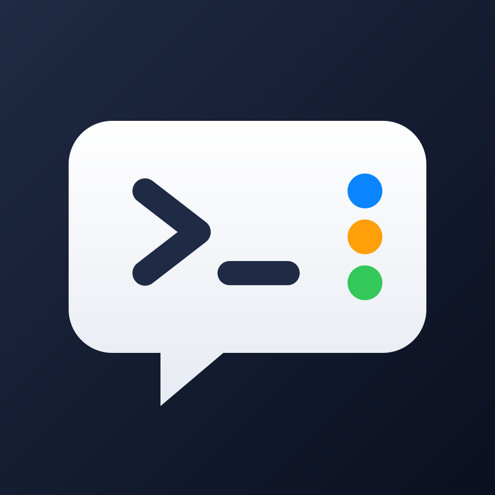

<p align="center"></p>

<h1 align="center">Shepherd</h1>

<p align="center"><strong>An unofficial iPhone client for herdr</strong></p>

<p align="center">Keep an eye on your <a href="https://herdr.dev">herdr</a> agents (Claude Code, Codex, …) on the go: connect over SSH, read chats, reply, approve – even by voice.</p>

> **Unofficial project.** Shepherd is not made, affiliated with or endorsed by the herdr project or its authors. “herdr” is used only to describe what the app works with.

---

## Features

- **Server list:** add several VPS/SSH connections, each with its own key. Keys stay in the iPhone's keychain, protected by Face ID.
- **Workspaces and agents, like on the desktop:** each agent shows its live status (working, needs you, done). A "Needs You" section at the top collects the ones waiting for you.
- **Readable chats:** the Claude Code screen turns into a chat.
  - Your messages appear as bubbles and answers as flowing text.
  - Tool calls collapse, and wide tables scroll sideways.
  - You can switch to the raw output at any time.
- **Reply and approve:** send prompts and answer approval dialogs with ↑ ↓ Enter, 1/2/3, y/n or Esc.
- **Rename chats:** use any text you like. The name also shows up in herdr on your desktop.
- **Start new agents:** browse the server's folders like in the Files app, then tap "Claude Code" or "Codex".
- **Real terminal:** full terminal emulation (SwiftTerm) with a row of special keys.
- **Voice control:** say things like "go to agent 2", "show me the folders" or "summarize what the agent did". The answer comes as text or is read aloud. Voice works in English and German.
- **Notifications:** get a push when an agent needs you or is done. You can switch them per agent or globally. They are delivered via [ntfy](https://ntfy.sh).
- **No paid Apple developer account needed:** install with a free Apple ID.

## Requirements

| | |
|---|---|
| **Mac** | Xcode 27, `brew install xcodegen` |
| **iPhone** | iOS 26 or later |
| **Apple ID** | a free one is enough |
| **Server** | herdr ≥ 0.9.5 (protocol 22), `nc` (OpenBSD netcat, default on Ubuntu), `base64`, `bash` |
| **SSH key** | **Ed25519**, public key in `~/.ssh/authorized_keys` on the server |
| optional | `python3` ≥ 3.8 and `curl` for notifications; Claude Code (`claude`) for voice interpretation and summaries |

> **RSA keys don't work.** The SSH library this app uses signs RSA only with SHA-1 (`ssh-rsa`), and OpenSSH 8.8 and later rejects that. To create a suitable key, run
> `ssh-keygen -t ed25519 -f ~/.ssh/id_ed25519_herdr`
> and then append `~/.ssh/id_ed25519_herdr.pub` to `~/.ssh/authorized_keys` on the server.

## Installation

```sh
git clone https://github.com/Tibilz/shepherd-ios.git
cd shepherd-ios
./scripts/generate.sh        # creates HerdrApp.xcodeproj
open HerdrApp.xcodeproj
```

When you open the project for the first time, Xcode asks about SwiftTerm's build plugin. Choose **Trust & Enable**.

### Install on your iPhone (free Apple ID)

1. In Xcode, open Settings → Accounts and add your Apple ID.
2. Change the bundle ID `de.kozarzewski.herdrapp` to your own, e.g. `com.yourname.herdrapp`. Do this in `project.yml`, then run `./scripts/generate.sh` again.
3. Select the **HerdrApp** target. Under Signing & Capabilities, set Team to *your name (Personal Team)*.
4. Connect your iPhone by cable. On the iPhone, turn on **Settings → Privacy & Security → Developer Mode**.
5. In Xcode, pick your iPhone as the destination and press **Run** (⌘R).
6. On first launch, go to **Settings → General → VPN & Device Management →** your developer profile → *Trust*.

**After 7 days**, the signature from a free Apple ID expires. Your data stays on the phone. To renew, run the app from Xcode again, or use [SideStore](https://sidestore.io), which renews the signature on the iPhone itself.

## Setup

### 1. Add an SSH key

Tap the key icon, then **+**. You can add the key in one of these ways:

- **From a password manager:** tap the key field, long-press, choose *AutoFill*, then your password manager, then your SSH key.
- **From the clipboard:** copy the private key in your password manager and tap **Paste from Clipboard**. Then tap *Clear Clipboard*.
- **From a file**, or type it in.

The key field is masked like a password; tap the eye to show it. The private key never leaves this iPhone and is not synced to iCloud. Face ID asks once when you open the app, and again after the app has been in the background for more than 5 minutes.

### 2. Add a server

In the server list, tap **+** and enter name, host, port, user and key.

On the first connection, the app shows the server's fingerprint. Compare it with the output of this command on the server:

```sh
ssh-keygen -lf /etc/ssh/ssh_host_ed25519_key.pub
```

If the fingerprint changes later, the app refuses to connect. You can reset it in the server settings.

**VPN:** if your server sits behind WireGuard, Cisco Secure Client or OpenVPN (Tunnelblick users: *OpenVPN Connect* on iOS), connect that VPN app first. Then use the server's internal address in Shepherd.

### 3. Notifications (optional)

Push notifications go through [ntfy](https://ntfy.sh), because the app's own push notifications would require a paid Apple account.

1. Install the free **ntfy** app on your iPhone.
2. In Shepherd, open a server and tap **⋯ → Notifications → Set Up**. The app shows what it will change on the server before it does anything.
3. In ntfy, subscribe to the topic shown, or scan the QR code. Then tap **Send Test Notification**.

Tapping a notification opens that agent directly. There are switches for all notifications, for each event and for each agent; the bell in the agent view toggles that agent.

**What gets installed on the server:**

- the folder `~/.config/herdr-notify/`
- depending on the server, one of:
  - a systemd user service
  - two crontab lines
  - a self-supervising background process

No sudo is needed. **Remove** in the app undoes all of it.

> **Privacy:** ntfy.sh is a public service. Your topic name is a random secret code. Notifications contain only the agent name, server name and status. To use your own ntfy server, set `ntfyServer` and `ntfyToken` in `config.json` on the server.

## Voice control

**Hold the mic button and speak.** You can also tap once to start and tap again to stop. The mic sits at the bottom of the server overview and next to the message field in an agent.

| You say … | What happens |
|---|---|
| "go to agent 2", "open the reviewer", "back", "terminal" | happens instantly, works offline |
| "yes", "approve", "no", "option 2" (while the agent waits) | the matching key is sent |
| inside an agent: "also write tests for the login" | sent to the agent as a message after 3 seconds; you can cancel before that |
| "show me the folders", "command: how much disk space is free" | Claude proposes a command, which only runs after you tap. Dangerous commands need a second confirmation. |
| "summarize what the agent did", "summarize the README" | the answer is shown as text or read aloud |

Speech recognition runs on the iPhone (Apple SpeechAnalyzer). **Claude Code on your server** interprets the commands and writes the summaries, using your own Claude subscription (`claude -p`). The app needs no API key. You choose the language (English or German), how answers are delivered and the voice under ⚙︎ in the server list.

## How it works

```
iPhone ──SSH──▶ server ──unix socket──▶ herdr
                   ├── claude -p (voice, summaries)
                   └── herdr-notify ──▶ ntfy.sh ──▶ ntfy app
```

The app talks to herdr's JSON socket API directly over SSH (`nc -U`). It subscribes to live events for status changes and reads agent output with `agent.read`. Nothing is installed on the server permanently unless you set up notifications.

| Folder | Contents |
|---|---|
| `App/` | SwiftUI app (iOS 26) |
| `Packages/HerdrKit` | protocol, client, live session, chat parser, voice logic, notify installer (no dependencies) |
| `Packages/HerdrSSH` | SSH transport (Citadel), key import, integration tests |
| `docs/superpowers/` | design and implementation plans (German) |

## Development

```sh
cd Packages/HerdrKit && swift test                                   # core logic
cd Packages/HerdrSSH && swift test                                   # key import
python3 -m unittest discover -s Packages/HerdrKit/Tests/notify       # herdr-notify
xcodebuild -scheme HerdrApp -destination 'platform=iOS Simulator,name=iPhone 17 Pro' -skipPackagePluginValidation build
```

Integration tests against a real server only use a separate herdr session named `herdrapp-test`:

```sh
# on the server
nohup herdr --session herdrapp-test server >/dev/null 2>&1 &
herdr --session herdrapp-test workspace create --label apptest
# locally
cd Packages/HerdrSSH
HERDR_IT_HOST=<ip> HERDR_IT_USER=<user> HERDR_IT_KEY=~/.ssh/id_ed25519 swift test --filter IntegrationTests
```

If a slow connection keeps Xcode from fetching the large dependencies (`swift-nio`, `swift-crypto`, …), you can configure local mirrors:

1. In `Packages/HerdrSSH`, run `swift package config set-mirror …`.
2. Run `scripts/generate.sh`, which copies the mirrors into the Xcode project.

## Notes

- This is an unofficial community project. It is not affiliated with or endorsed by herdr. The app icon is an original design.
- Tested with herdr 0.9.5 and Claude Code 2.1 on Ubuntu.

## License

[MIT](LICENSE)
